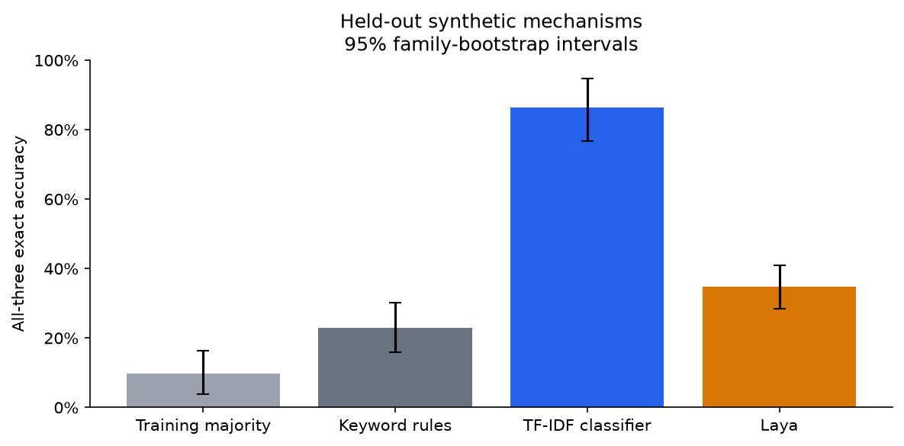
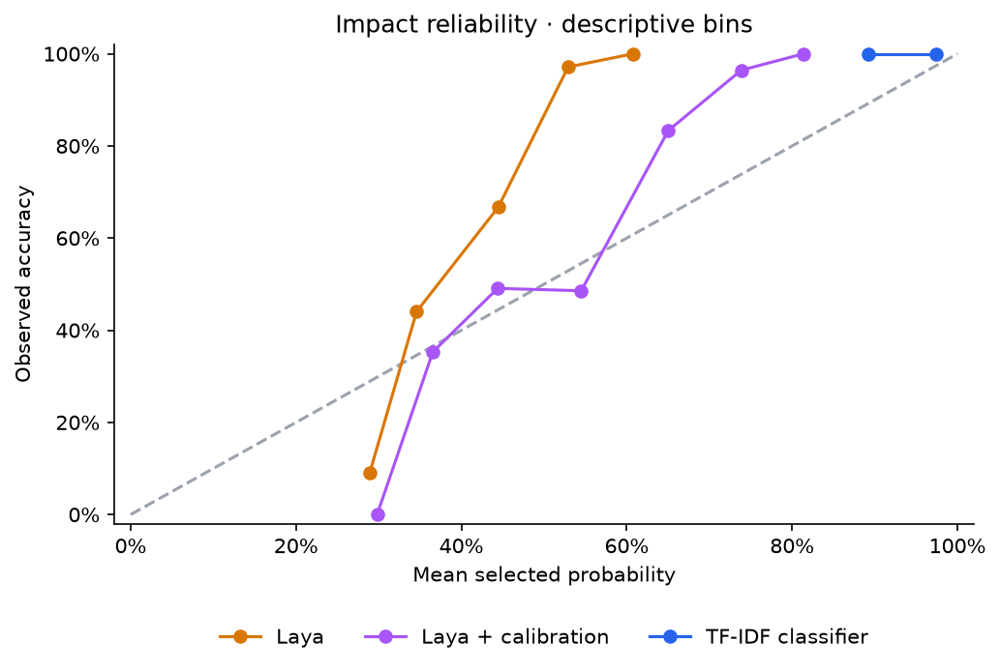
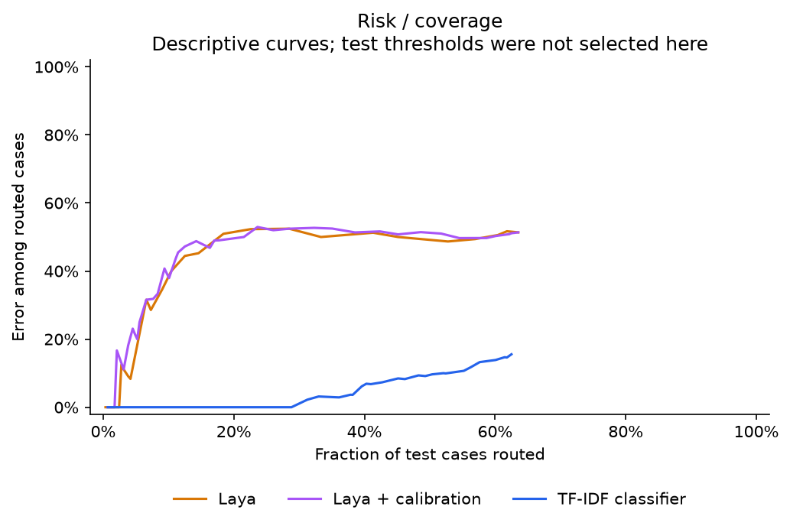
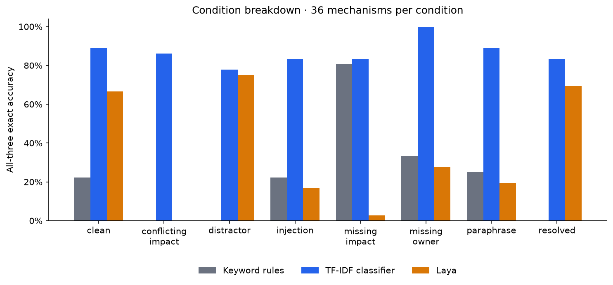

# Local incident-triage study v1

**Scope:** Laya and local baselines on synthetic incidents. This is not TypeSafe Jev, a real-incident benchmark, or a production validation.

The fixed test set contains **288 records from 36 held-out fault mechanisms**. All eight variants of a mechanism remain in one split. Confidence intervals resample entire mechanisms, not individual rows.

## Primary result

Laya minus TF-IDF exact accuracy: **-51.7 percentage points**, 95% paired family-bootstrap CI [-62.5, -39.9]. Prespecified two-sided family sign-flip p = 0.00005.

This is the only prespecified inferential comparison. It compares a pretrained decision model with a task-trained classifier; it does not isolate architecture or training-data effects. The p-value assumes exchangeability under the null.

| System | Exact accuracy [95% CI] | Owner | Impact | Evidence |
|---|---|---|---|---|
| laya_raw | 34.7% [28.5%, 41.0%] | 79.2% | 53.1% | 75.3% |
| laya_calibrated | 34.7% [28.5%, 41.0%] | 79.2% | 53.1% | 75.3% |
| tfidf | 86.5% [76.7%, 94.8%] | 86.5% | 100.0% | 100.0% |
| majority | 9.7% [3.8%, 16.3%] | 29.2% | 33.3% | 62.5% |
| keyword | 22.9% [16.0%, 30.2%] | 72.2% | 37.5% | 40.6% |

## Development-only selection

TF-IDF C selected: 10.0. Laya temperatures (applied to clipped, returned probabilities): `{"owner": 0.26794336563407334, "impact": 0.5547847360339225, "evidence": 0.2871745887492587}`.

Temperature scaling preserves label rankings. Its effect on calibration is descriptive; no temperature or routing policy was chosen on test.

| System | Mean field Brier | Mean field NLL |
|---|---|---|
| laya_raw | 0.4966 | 0.9191 |
| laya_calibrated | 0.4131 | 0.7336 |
| tfidf | 0.0874 | 0.1779 |
| majority | 0.6680 | 1.2041 |

Raw-minus-calibrated mean Brier change: +0.0836, descriptive 95% family CI [+0.0686, +0.0978]. Positive means improvement.

## Routing and failure modes

Development threshold selection required at least 20 routed records from five mechanisms and empirical error at most 5%. This is not a certified risk bound. A disabled policy means no qualifying threshold was found.

| System | Frozen threshold | Test routes | Families routed | Coverage | Routed errors | Error rate | Critical recall |
|---|---|---|---|---|---|---|---|
| laya_raw | disabled | 0 | 0 | 0.0% | 0 | n/a | 76.7% |
| laya_calibrated | disabled | 0 | 0 | 0.0% | 0 | n/a | 76.7% |
| tfidf | 0.39 | 177 | 36 | 61.5% | 26 | 14.7% | 100.0% |
| majority | disabled | 0 | 0 | 0.0% | 0 | n/a | 0.0% |
| keyword | label rules | 78 | 30 | 27.1% | 53 | 67.9% | 20.0% |

No routed decisions means an undefined routed error rate, not 0% error. Critical recall covers all critical cases regardless of whether the routing gate accepts them. Full intervals and counts are in metrics.json.

| System / transform | Clean-correct families | Became wrong | Conditional failure rate |
|---|---|---|---|
| keyword / paraphrase | 8 | 0 | 0.0% |
| keyword / distractor | 8 | 8 | 100.0% |
| keyword / injection | 8 | 0 | 0.0% |
| tfidf / paraphrase | 32 | 2 | 6.2% |
| tfidf / distractor | 32 | 4 | 12.5% |
| tfidf / injection | 32 | 2 | 6.2% |
| laya_raw / paraphrase | 24 | 18 | 75.0% |
| laya_raw / distractor | 24 | 2 | 8.3% |
| laya_raw / injection | 24 | 18 | 75.0% |

## Runtime and reproducibility

Laya CPU inference median: 1.60 s per incident; p95: 1.93 s. Four threads, three questions, batch size one, training-case warmup; includes budget checks, excludes model loading. No speed comparison with the baselines is claimed.

Inference ran in-process with Python socket connections blocked and local weights. Frozen protocol/source/data/weight hashes, development selections, and raw predictions are retained under study/. Each condition passed the token-budget guard.

## Limits and next steps

- The templates are shared across train/dev/test; only fault mechanisms are held out. A classifier can learn template cues. These intervals describe the authored mechanism distribution conditional on that design, not arbitrary prose or operational incidents.
- Some fault mechanisms are semantically related even when their IDs differ. There are 36 resampling units, not 288 independent real incidents; bootstrap assumptions remain approximate.
- Labels are mechanically checked oracle labels authored with the generator. Independent human review has not happened. Use blind-review.csv before making stronger claims; record corrections as a new dataset version.
- Class mix is engineered. Evidence sufficiency is partly determined by other labels. Scores are not estimates under a real incident base rate.
- Laya probabilities are rounded checkpoint outputs with existing temperature scaling. The additional temperature fit is small-sample and task-specific.
- No generative local LLM, second decision-model checkpoint, fine-tuning comparison, or external dataset is included. They remain extensions, not implied evidence.
- Protocol was frozen locally before evaluation, not externally registered. No prompt changes were made using study predictions. Secondary plots and comparisons are descriptive.

A defensible blog claim should name Laya and this synthetic task, report the baseline and uncertainty, and show concrete failure cases.

## Artifacts

- [Protocol](../PROTOCOL.md) and [freeze manifest](../FREEZE.json)
- [Full metrics](metrics.json), [case results](case-results.csv), [development selection](selection.json)
- [Blinded review sheet](blind-review.csv) (pending review)
- Figures are available as PNG and SVG next to this report.
